# Лаба 1. HA Postgres Cluster (Patroni + Zookeeper + HAProxy)

Задача: развернуть и настроить высокодоступный кластер Postgres из двух нод под управлением Patroni, Zookeeper в роли DCS и HAProxy как единая точка входа.

Делали локально на маке (M-чип, arm64), докер через OrbStack. Версии которые реально поднялись: PostgreSQL 15.19, Patroni 4.1.5, cp-zookeeper 7.7.1, HAProxy 3.0.

Что лежит в репе:
- `Dockerfile` - образ postgres:15 + patroni в venv
- `docker-compose.yml` - 2 ноды постгреса, зукипер, хапрокси
- `postgres0.yml`, `postgres1.yml` - конфиги патрони для нод
- `haproxy.cfg` - конфиг хапрокси
- `screenshots/` - скрины
- `logs/` - полные логи контейнеров после прогонов

## Часть 1. Поднимаем Postgres

Dockerfile взяли из методички без изменений. postgres0.yml тоже, postgres1.yml сделали из него, поменяли имя ноды (`postgresql1`), адреса restapi и postgresql на `pg-slave`, `data_dir` и `pgpass`.

В compose пришлось поменять пару вещей:

1. Папка у нас называется `aks:lab1`, а compose по умолчанию берет имя проекта из имени папки, с двоеточием там так себе. Поэтому прописали `name: postgres_lab`.
2. Двоеточие в пути ломает короткую запись маунта `./haproxy.cfg:/usr/local/etc/haproxy/haproxy.cfg` (докер режет строку по `:`), падает с `invalid volume specification`. Расписали маунт длинной записью (`type: bind`, `source`, `target`). Это для части 3, но упомянем тут.

Запуск (сначала без хапрокси, как в методичке):

```bash
docker compose up -d --build pg-master pg-slave zoo
docker ps
```

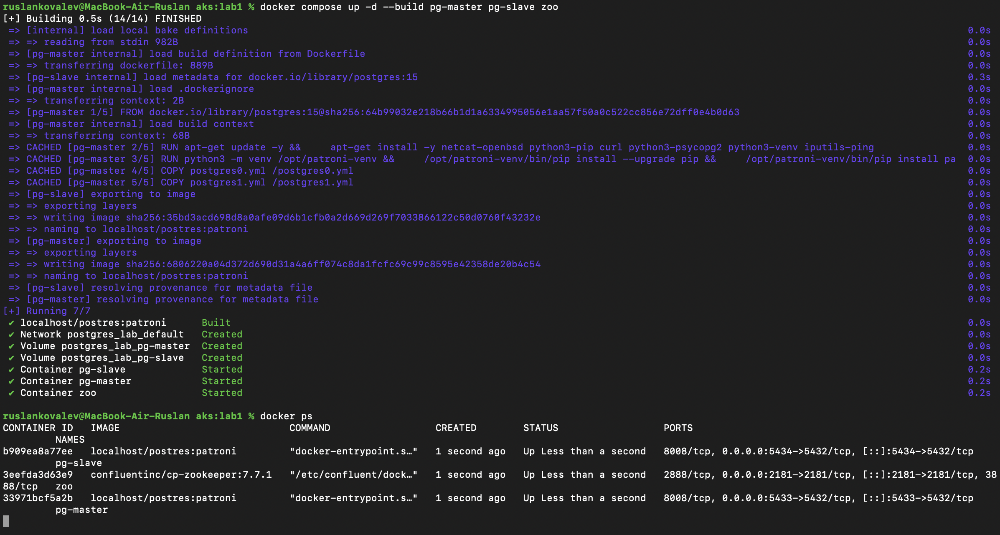

Смотрим логи нод. Как и предупреждали в методичке, лидером стал не pg-master, а pg-slave (`postgresql1`). pg-master пришел в кластер, увидел что лок уже у postgresql1 и забутстрапился с него через basebackup, дальше работает как secondary. Пара строк `FATAL: could not start WAL streaming: replication slot "postgresql0" does not exist` в самом начале - нормально: реплика стартанула на долю секунды раньше, чем лидер создал для нее слот (`use_slots: true`), через секунду стрим пошел (`started streaming WAL from primary`):

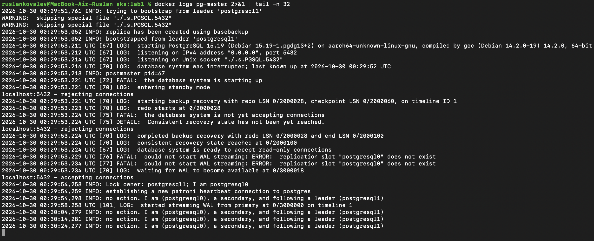

pg-slave инициализировал новый кластер, взял лок и стал лидером, потом назначил pg-master синхронной репликой (`synchronous_mode: true`):

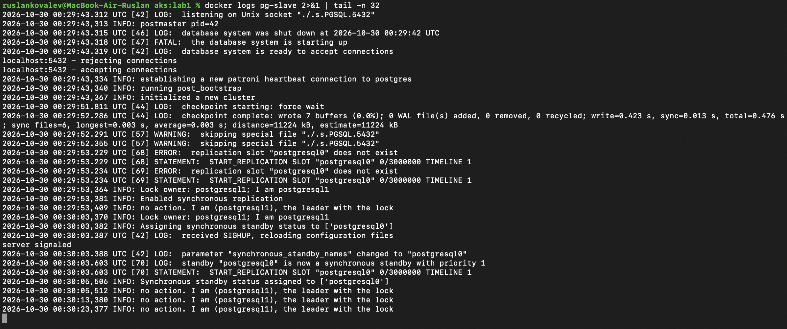

Зукипер поднялся без ошибок (порт 2181 проброшен, видно в `docker ps` на скрине выше). Строчки `Unable to read additional data from client` и `Expiring session` - это сессии патрони, которые закрывались при старте нод, не ошибки:

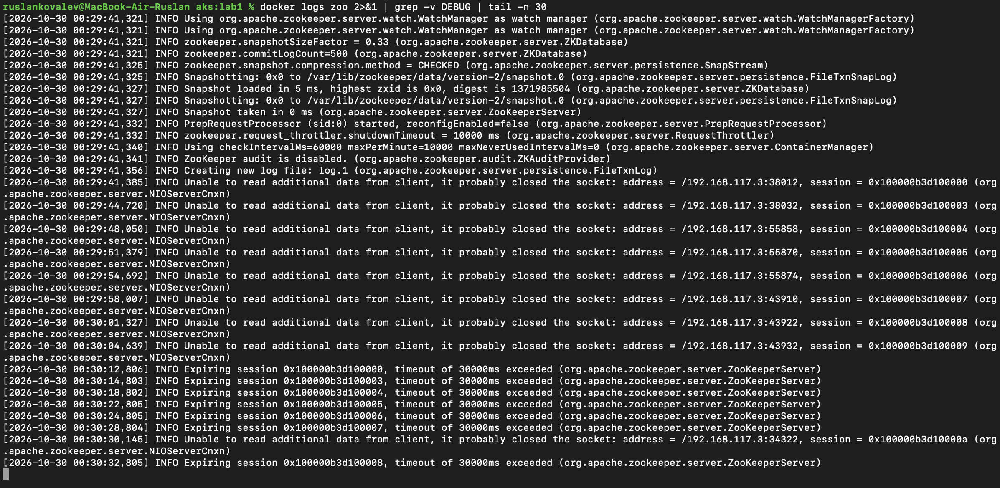

Еще удобно смотреть состояние кластера через `patronictl` (этого в методичке нет, но так нагляднее):

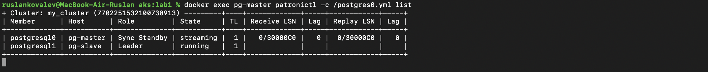

### Вопрос: expose vs ports

`ports` публикует порт контейнера на хост, т.е. на хост (мак). 5433 и 5434 нужны, чтобы цепляться к нодам клиентом с хоста, поэтому они в `ports`.

`expose` на хост ничего не пробрасывает. Он только говорит, что контейнер слушает этот порт, и он доступен другим контейнерам в той же docker-сети. Вообще в compose-сети контейнеры и так видят все порты друг друга, так что `expose` тут скорее как документация.

8008 - это REST API патрони. Он нужен только внутри: ноды ходят друг к другу, и хапрокси делает по нему health check. Наружу его светить незачем, тем более что у патрони там есть ручки типа restart/failover/switchover, а по умолчанию без авторизации. Если бы 8008 был в `ports`, он бы тоже стал доступен извне (`ports` по сути включает в себя `expose`).

### Вопрос: пересоберется ли образ при перезапуске

При обычном `docker compose up` / `docker compose restart` - нет. Compose билдит образ только если его еще нет (у нас `localhost/postres:patroni` уже есть), иначе просто берет готовый.

- Отредактировали `postgresX.yml` - тоже не пересоберется. Конфиги копируются в образ через `COPY` на этапе сборки, поэтому контейнер продолжит жить со старым конфигом, пока не сделаешь `docker compose up -d --build` (или `docker compose build`). Мы на это как раз наступили в конце лабы, когда меняли `unix_socket_directories`, пришлось пересобирать.
- Поменяли Dockerfile - то же самое, без `--build` ничего не произойдет.

С `--build` сборка идет с кешем слоев: пересобирается слой, который изменился, и все после него. Если поменять только yml - переделаются только слои `COPY`, а тяжелые `apt-get` и `pip install` возьмутся из кеша (на скрине 01 видно что все шаги `CACHED`). Если поменять строчку с `RUN apt-get ...` - пересоберется почти все.

По-хорошему конфиги лучше монтировать volume'ом, тогда и пересобирать ничего не надо.

## Часть 2. Проверяем репликацию

Клиент - обычный `psql` (стоит локально на маке). Подключаемся к обеим нодам, `pg_is_in_recovery()` сразу показывает кто реплика: на 5433 (pg-master) `t`, на 5434 (pg-slave) `f`. То есть лидер у нас pg-slave:

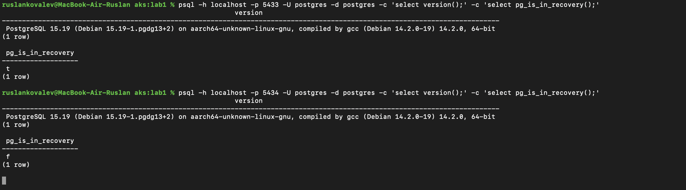

Поэтому таблицу создаем на 5434 (лидер), в методичке написано писать в того, кто лидер:

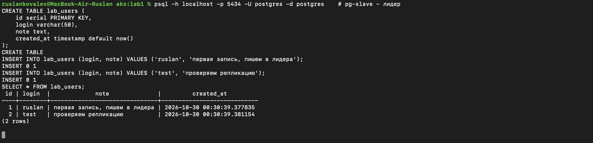

На реплике (5433) таблица появилась сама вместе с данными:

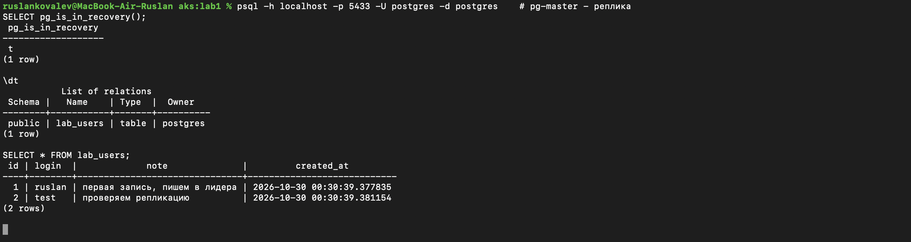

Пробуем писать в реплику - отказ, нода в read-only:

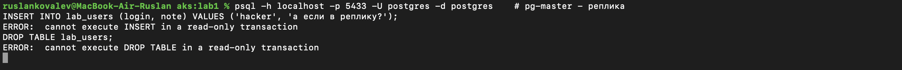

## Часть 3. Высокая доступность через HAProxy

Добавили хапрокси в compose и `haproxy.cfg` из методички. В конфиг добавили от себя секцию `resolvers docker` (днс докера 127.0.0.11) и `resolvers docker init-addr last,libc,none` в `default-server`. Без этого хапрокси резолвит `pg-master`/`pg-slave` один раз при старте. Если ноду остановить и запустить заново, она может получить другой ip, и хапрокси будет стучаться на старый.

Как хапрокси понимает куда слать: `option httpchk` дергает `GET /` на порту 8008 (REST патрони). Патрони отвечает 200 только на лидере, на реплике 503. Так что трафик всегда идет только на мастер.

Грабли с портами. Сначала оставили как в методичке, `5432:5432` и `7000:7000`. Контейнеры поднялись, но:

- при подключении на `localhost:5432` попали в локальный постгрес, который уже стоял на маке, а не в хапрокси. `inet_server_addr` = `::1` и таблицы `lab_users` нет:

  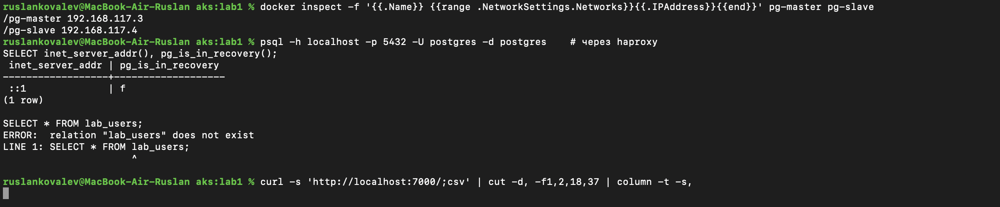

- `curl localhost:7000` возвращал пустоту. Оказалось, на маке 7000 занят AirPlay Receiver'ом:

  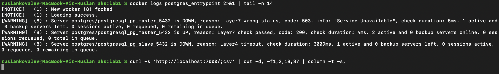

Поменяли снаружи на `5435:5432` и `7001:7000` (внутри контейнера порты те же, haproxy.cfg не трогали).

Перезапускаем проект, все 4 контейнера живы:

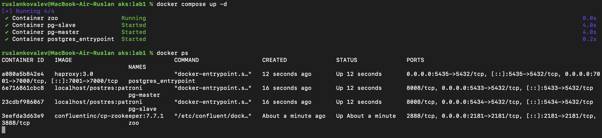

В логах хапрокси видно, что pg-master (реплика) помечен DOWN с 503, т.е. живой сервер в бэкенде один - лидер:

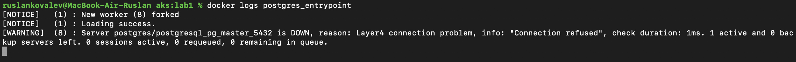

Подключаемся через entrypoint (5435). `inet_server_addr` = 192.168.117.2 - это ip pg-slave, т.е. лидера, данные на месте. Статистика хапрокси (`/;csv` со страницы статы) тоже показывает: slave UP (L7OK), master DOWN (L7STS - неправильный статус, тот самый 503):

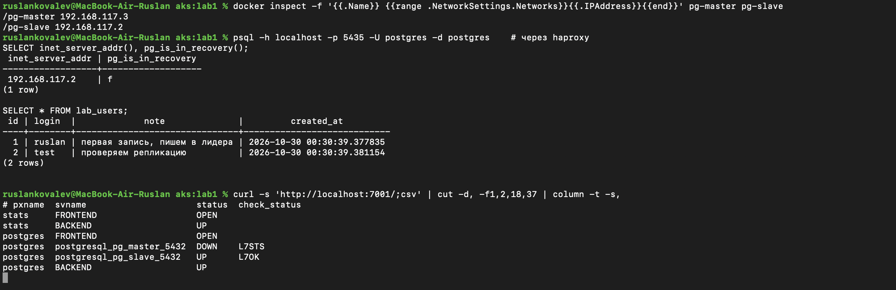

## Задание. Выключаем мастер

Текущий лидер - pg-slave. Гасим его:

```bash
docker stop pg-slave
```

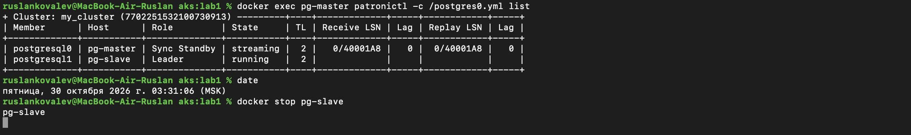

Логи pg-master (бывшая реплика). В 00:31:06.989 у нее отвалилась репликация (`replication terminated by primary server`), а в 00:31:07.915 она уже `promoted self to leader by acquiring session lock`, перешла на новый timeline 3 и стала принимать подключения на запись. Меньше секунды.

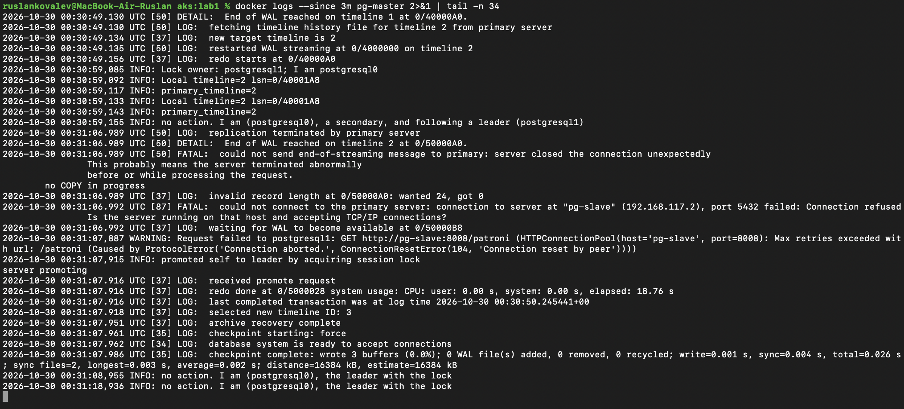

Хапрокси: pg-slave ушел в DOWN (L4TOUT - контейнера нет), pg-master стал UP (L7OK, теперь он отвечает 200):

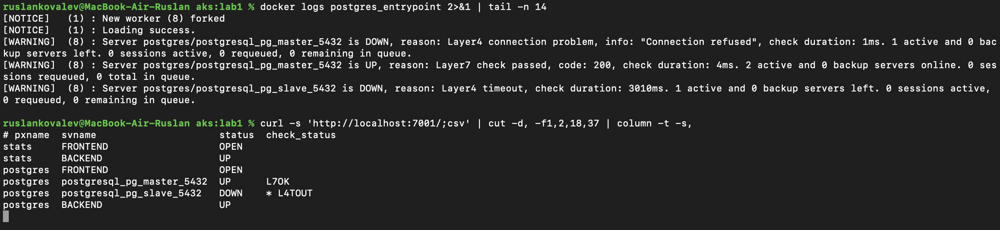

`docker ps -a` и `patronictl list`: pg-slave Exited, в кластере postgresql0 - Leader, postgresql1 - stopped:

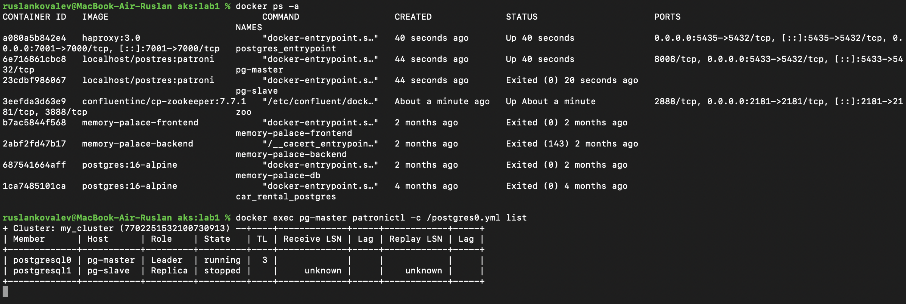

Подключаемся через entrypoint по тому же адресу `localhost:5435`. Теперь отвечает 192.168.117.3 (pg-master), `pg_is_in_recovery = f`. Старые данные на месте, новые записи вставляются:

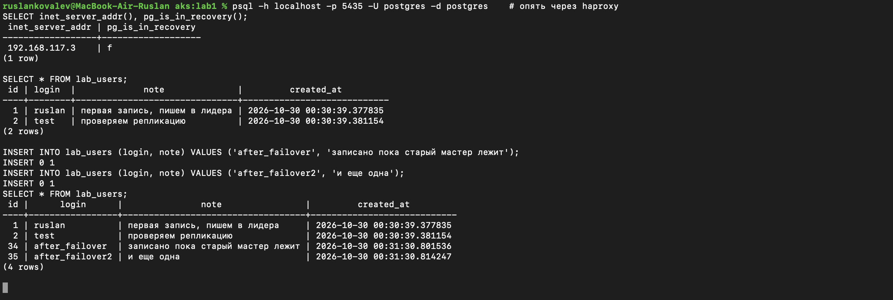

Итого: получилось. Что произошло:

1. `docker stop` шлет SIGTERM, патрони штатно останавливает постгрес и сам удаляет лидерский ключ в зукипере, не дожидаясь ttl.
2. Реплика на следующем цикле видит, что лидера нет. Она синхронная реплика (`synchronous_mode: true`, только ее и можно промоутить), отставания нет, поэтому она берет лок в зукипере и делает promote. Новый timeline 3.
3. Хапрокси по health check'у (раз в 3 сек, `fall 3 rise 2`) замечает, что старый мастер умер, а новый отвечает 200, и переключает трафик.
4. Клиенту ничего менять не надо, адрес тот же - `localhost:5435`. Но уже открытые соединения рвутся (`on-marked-down shutdown-sessions`), приложение должно уметь переподключаться.
5. Данные не потеряли, т.к. репликация синхронная: коммит на лидере подтверждается только после записи на реплике.

Мелочь, которую заметили: после переключения id в serial прыгнул с 2 на 34. Это нормально: постгрес пишет в WAL значения sequence с запасом на 32 вперед, и новый мастер продолжает с этого записанного значения. Дырки в serial - штатное поведение.

## Доп. задание (желтое №1): нода возвращается и сама догоняет данные

Запускаем обратно `docker start pg-slave`. Патрони на ней видит, что лок у postgresql0, а timeline у нее 2 против 3 у лидера. Она стартует как secondary, скачивает history file нового timeline и начинает стримить WAL с лидера:

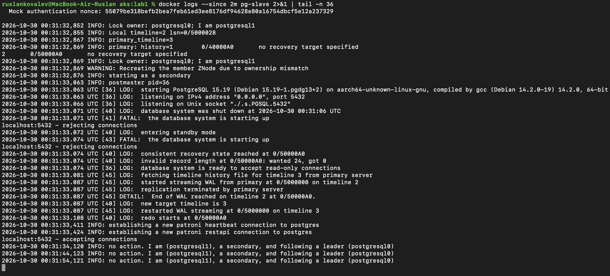

В кластере снова две ноды, pg-slave теперь Sync Standby, lag 0. В хапрокси она DOWN (L7STS), потому что реплика и отвечает 503, так и должно быть:

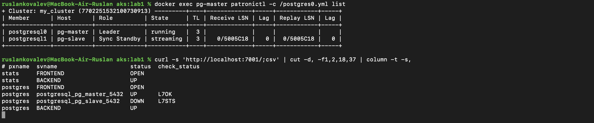

Подключаемся напрямую к вернувшейся ноде (5434). Строки `after_failover`, записанные пока она лежала, уже есть, и писать в нее нельзя, она теперь реплика:

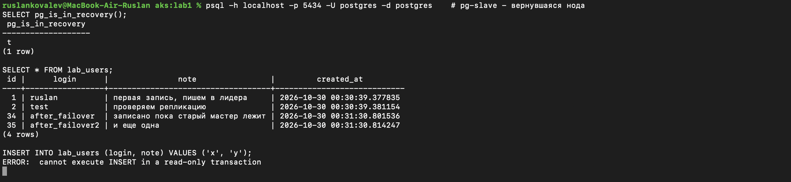

Честно говоря, руками для этого почти ничего настраивать не пришлось, патрони так умеет из коробки. Нужны только `use_pg_rewind: true` и `wal_log_hints: on`, чтобы старый мастер мог откатить свои лишние изменения и встать репликой, и слоты репликации (`use_slots`), чтобы лидер не удалил WAL, который нужен отставшей реплике. В нашем случае с `docker stop` даже pg_rewind не понадобился: остановка была штатная, и WAL старого мастера закончился ровно в точке переключения (`End of WAL reached on timeline 2 at 0/50000A0`).

А вот с жестким падением это сломалось, см. дальше.

### Жесткое падение: docker kill вместо stop

Решили проверить, что будет если мастер не останавливать вежливо, а убить (`docker kill` = SIGKILL, как будто выдернули питание). Параллельно в цикле дергали `select inet_server_addr()` через хапрокси раз в 2 секунды:

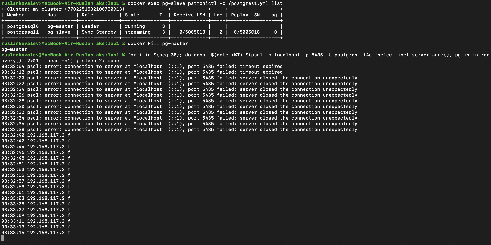

Тут уже видно окно недоступности около 36 секунд (03:32:04 - 03:32:40):

- первые 2 попытки - `timeout expired`, хапрокси еще считает мертвую ноду живой (ему надо 3 проваленных проверки по 3 сек);
- потом `server closed the connection unexpectedly` - живых серверов в бэкенде нет вообще: старый мастер мертв, а реплика еще не повышена;
- реплика повысилась только в 00:32:34 (по UTC, на маке 03:32:34). Убитый патрони не успел удалить ключ в зукипере, поэтому пришлось ждать, пока он протухнет сам (`ttl: 30`):

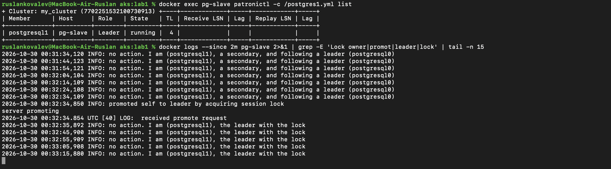

Получается, `ttl` в DCS - это и есть почти все время простоя при настоящей аварии. Можно уменьшить, но тогда больше риск ложных переключений при сетевых лагах.

И тут нашелся баг в конфиге из методички. После `docker start pg-master` нода не вернулась в кластер, patronictl показывал `start failed`. В логах (`logs/kill_with_socket_in_datadir/pg-master.log`):

```
INFO: running pg_rewind from postgresql1
INFO:  stderr=pg_rewind: servers diverged at WAL location 0/5005C18 on timeline 3
pg_rewind: rewinding from last common checkpoint at 0/5000108 on timeline 3
pg_rewind: error: could not open target file "/var/lib/postgresql/data/postgresql0/.s.PGSQL.5432": No such device or address
ERROR: Failed to rewind from healthy primary: postgresql1
...
FATAL:  could not start WAL streaming: ERROR:  requested starting point 0/6000000 on timeline 3 is not in this server's history
...
FATAL:  lock file "./.s.PGSQL.5432.lock" is empty
INFO: failed to start postgres
```

После kill старый мастер успел записать в WAL кусок, которого нет на новом мастере (servers diverged). Значит без pg_rewind ему никак, а pg_rewind падает. Причина в `unix_socket_directories: '.'`: постгрес кладет unix-сокет прямо в data_dir, а pg_rewind копирует data_dir и на сокете ломается. При `docker stop` это не всплывало, потому что там rewind не нужен.

Фикс - в обоих `postgresX.yml` вынесли сокет в стандартную папку:

```yaml
  parameters:
    unix_socket_directories: '/var/run/postgresql'
```

(и пересобрали образ, см. вопрос про пересборку выше)

Проверили еще раз с нуля (`docker compose down -v`, пересборка, подняли все 4 контейнера). Сокеты теперь в `/var/run/postgresql`, лидер в этот раз pg-master:

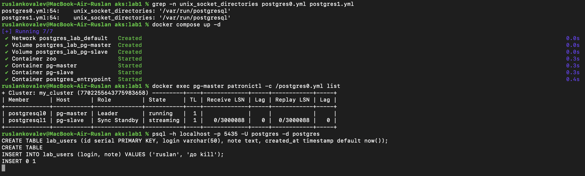

Снова `docker kill` лидера. Примерно через 30 сек (опять ttl) pg-slave стал лидером, через хапрокси пишем новую строку, пока убитая нода лежит. Потом `docker start pg-master`:

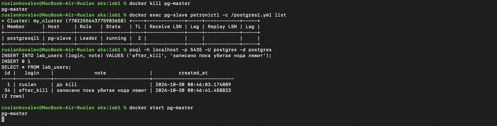

Теперь в логах вернувшейся ноды все как надо: патрони видит, что у нее timeline 1, а у лидера уже 2, запускает pg_rewind. Тот находит точку расхождения (`servers diverged at WAL location 0/302F348`), откатывает лишнее до последнего общего чекпоинта и пишет `pg_rewind: Done!`. После этого нода стартует как реплика и стримит WAL с лидера по timeline 2:

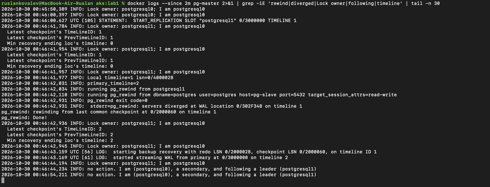

В кластере опять две ноды, lag 0. На вернувшейся ноде есть строка `after_kill`, записанная без нее:

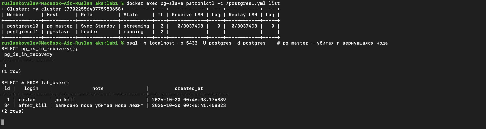

Так что "улучшение" для желтого задания у нас по факту такое: возврат ноды патрони делает сам, но чтобы он работал и после жесткого падения, а не только после штатной остановки, пришлось вынести unix-сокет из data_dir. Плюс резолвер в хапрокси, чтобы вернувшаяся нода находилась по новому ip.

## Выводы

- Patroni + Zookeeper + HAProxy реально дают автоматический failover: при падении мастера реплика сама становится мастером, хапрокси сам переключает трафик, клиенту адрес менять не нужно.
- Время простоя зависит от того, как упал мастер. При штатной остановке (`docker stop`) - меньше секунды, патрони сам отдает лок. При жестком падении (`kill`) - примерно `ttl` (30 сек) плюс health check'и хапрокси.
- `synchronous_mode` гарантирует, что при failover не теряются закоммиченные данные, но в кластере из двух нод мастер будет ждать подтверждения от реплики на каждый коммит.
- Вернувшаяся нода сама становится репликой и догоняет данные (pg_rewind + стриминг WAL), но только если pg_rewind может отработать. Конфиг из методички с `unix_socket_directories: '.'` ломает это после жесткого падения.
- Слабое место схемы: зукипер и хапрокси в одном экземпляре, сами по себе это single point of failure. Для настоящей HA их тоже надо дублировать (3 ноды зукипера, 2 хапрокси с keepalived/VIP).
