# Лаба 2. Loki + Zabbix + Grafana

Задача: подключить к тестовому сервису Nextcloud мониторинг и логирование и сделать визуализацию через Grafana.

Делали локально на маке (M-чип), докер через OrbStack. Что поднялось: Nextcloud 29.0.6, Loki и Promtail 2.9.0, Grafana 11.2.0, Zabbix 6.4.21 (server + web на Postgres 15).

файлы:
- `docker-compose.yml` - весь стенд: nextcloud, loki, promtail, grafana, zabbix + postgres
- `promtail_config.yml` - конфиг promtail, откуда брать логи и куда слать
- `template.yml` - шаблон Zabbix для пинга некстклауда
- `dashboards/` - JSON двух дашбордов из задания
- `screenshots/` - скрины

## Часть 1. Логирование

Compose и конфиг promtail взяли из методички (в PDF поехали отступы, поправили). Одно изменение: маунт `./promtail_config.yml` расписали длинной записью (`type: bind`). Папка у нас лежит внутри `aks:lab1`, а с двоеточием в пути короткая запись `./file:/path` не работает, на этом уже обожглись в первой лабе.

Как это работает: Nextcloud пишет `nextcloud.log` в свою папку data, это volume `nc-data`. Тот же volume примонтирован в promtail в `/opt/nc_data`. Promtail читает оттуда `*.log`, вешает метку `job=nextcloud_logs` и пушит в Loki.

Поднимаем:

```bash
docker compose up -d
docker ps
```

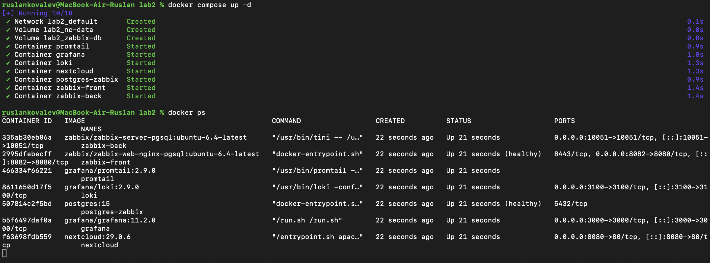

Заходим на `localhost:8080`, создаем учетку админа. База SQLite по умолчанию, для теста норм:

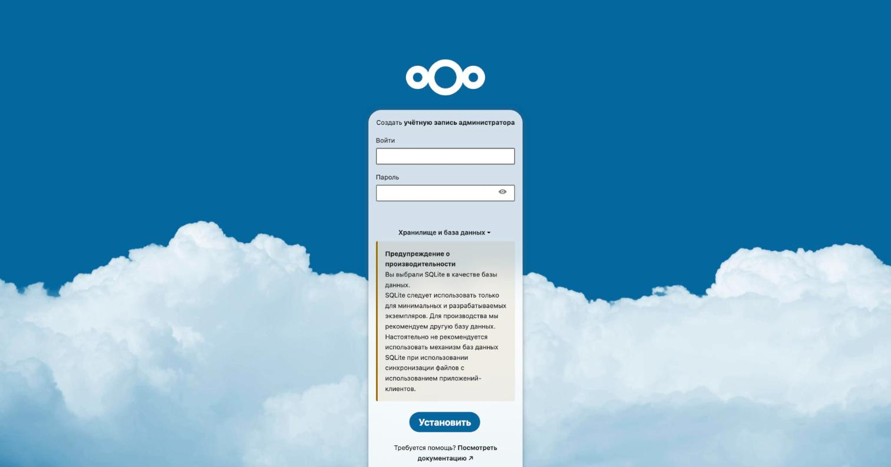

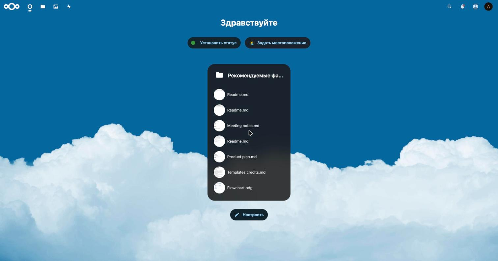

Проверяем, что `nextcloud.log` появился и в него пишется:

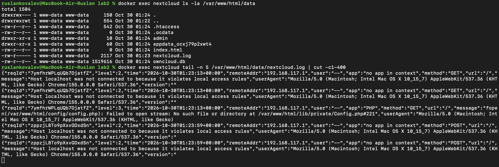

В логах promtail есть нужные строчки: `Adding target` с нашим `job=nextcloud_logs`, `Seeked /opt/nc_data/nextcloud.log` и `tail routine: started`. Значит файл подцепился. Если смотреть просто `tail` логов promtail, там все забито событиями file watcher'а (некстклауд постоянно трогает `owncloud.db-wal`), поэтому нужное вытащили grep'ом:

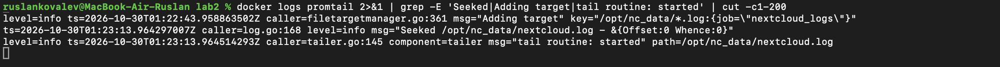

## Часть 2. Мониторинг

Заходим в Zabbix (`localhost:8082`, Admin / zabbix). Data collection → Templates → Import, грузим `template.yml`:

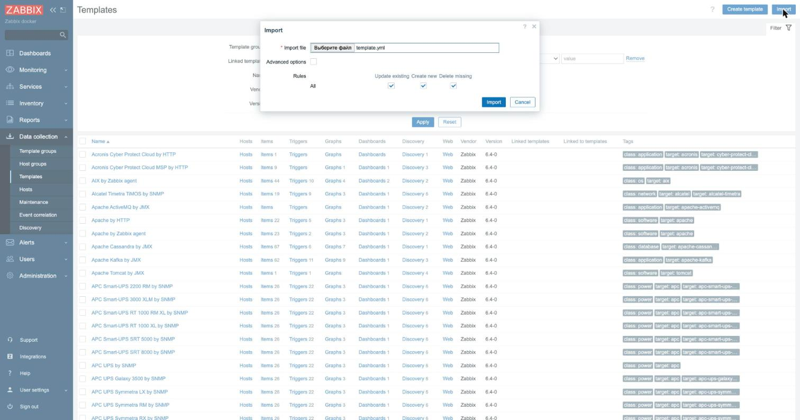

Zabbix сначала показал diff что добавится, потом спросил про удаление отсутствующих элементов. Шаблон новый, так что ок. Шаблон появился:

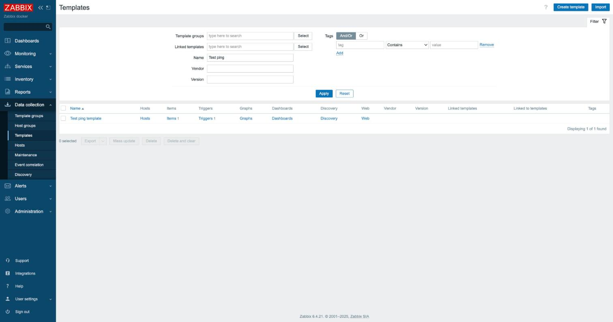

Шаблон делает HTTP-запрос на `http://{HOST.HOST}/status.php`, достает из ответа поле `maintenance` и превращает `false/true` в `healthy/unhealthy`. Триггер срабатывает, если последнее значение `unhealthy`.

Чтобы Zabbix мог ходить в Nextcloud по имени контейнера, добавляем `nextcloud` в trusted_domains (иначе некстклауд отвечает только на localhost):

```bash
docker exec -u www-data nextcloud php occ config:system:set trusted_domains 1 --value="nextcloud"
```

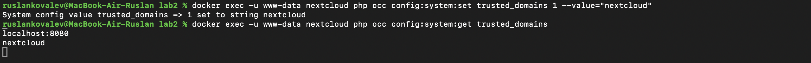

Data collection → Hosts → Create host. Host name = `nextcloud`, это имя контейнера, оно же подставится в `{HOST.HOST}`. Видимое имя любое, группа Applications, шаблон Test ping template. Интерфейс не нужен, т.к. айтем HTTP agent, его опрашивает сам zabbix-server:

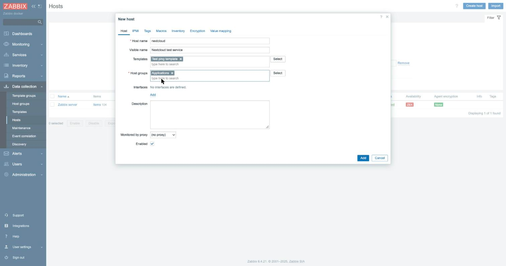

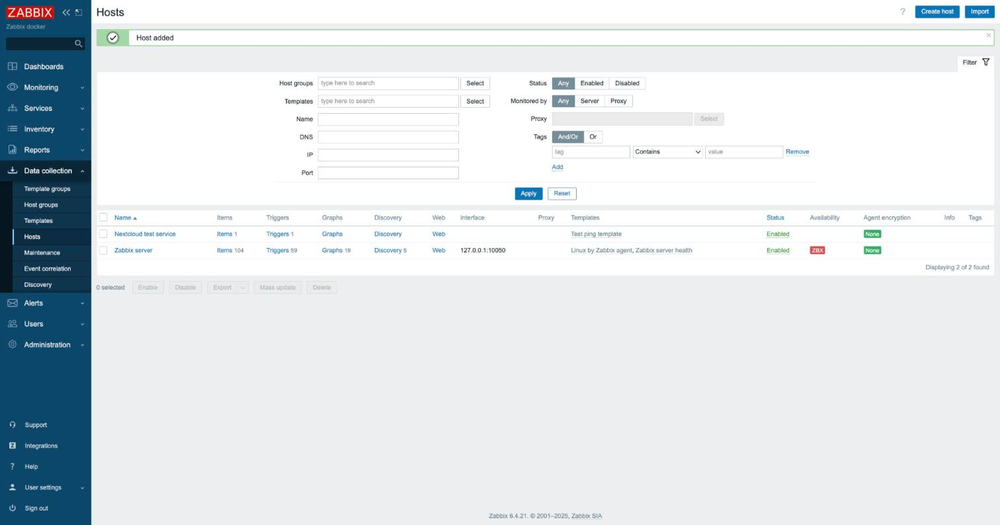

Через минуту в Monitoring → Latest data пришло `healthy`:

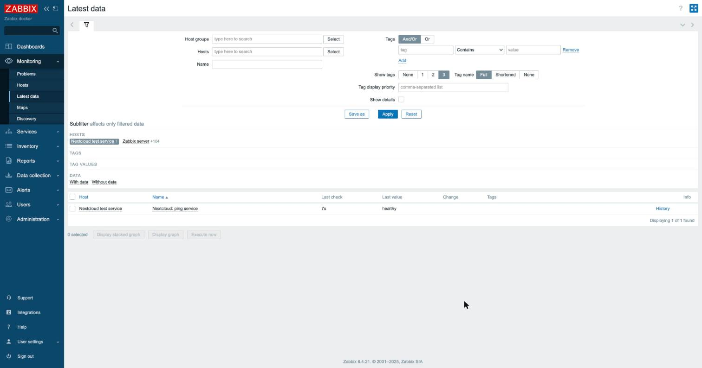

Проверили триггер. Включили maintenance mode в некстклауде, `status.php` стал отдавать `"maintenance":true`:

```bash
docker exec -u www-data nextcloud php occ maintenance:mode --on
```

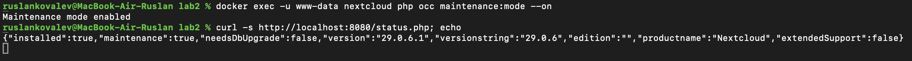

На следующей проверке в Monitoring → Problems появилась проблема Disaster "Nextcloud is in maintenance mode":

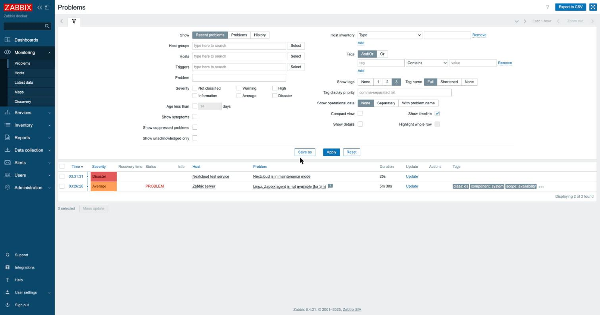

Выключили обратно:


Через минуту проблема закрылась, появилось Recovery time (вкладка History):

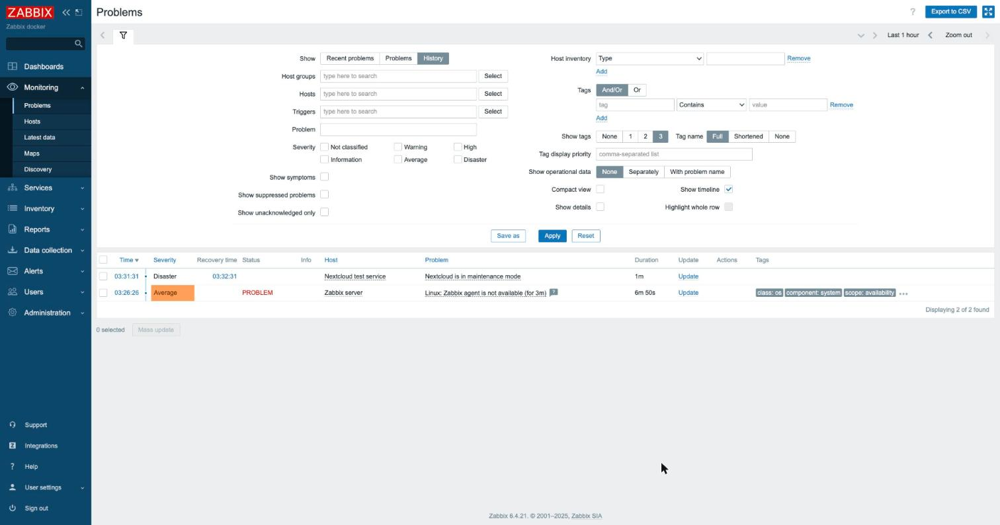

(вторая проблема "Zabbix agent is not available" - это дефолтный хост Zabbix server, агента в compose нет, к лабе не относится)

## Часть 3. Визуализация

Ставим плагин Zabbix в графану, как в методичке:

```bash
docker exec -it grafana bash -c "grafana cli plugins install alexanderzobnin-zabbix-app"
docker restart grafana
```

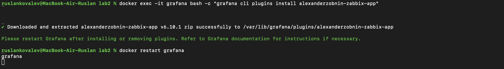

Встал плагин версии 6.10.1. Идем в Administration → Plugins → Zabbix:

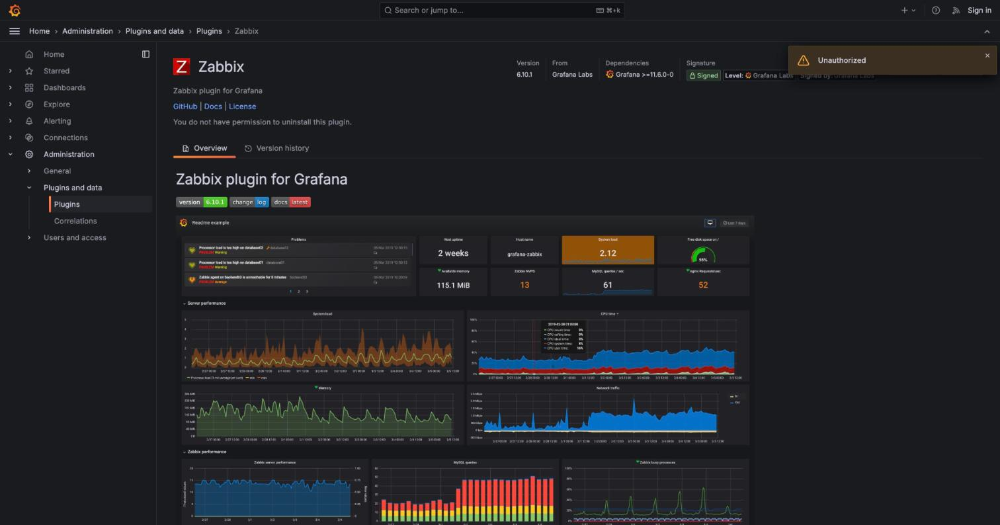

Тут сразу две странности. Первая: в Dependencies написано Grafana >=11.6.0, а у нас по методичке 11.2.0 (к этому вернемся ниже). Вторая: нет кнопки Enable. Мы заходим анонимно (`GF_AUTH_ANONYMOUS_ENABLED`), у анонима нет полноценной сессии, графана сыпет `Unauthorized` (видно в углу скрина). Плагин включили тем же запросом, который делает кнопка, отправили его из консоли браузера на странице графаны:

```js
await fetch('/api/plugins/alexanderzobnin-zabbix-app/settings', {
  method: 'POST', headers: {'Content-Type': 'application/json'},
  body: JSON.stringify({enabled: true, pinned: true, jsonData: {}})
})
// 200 {"message":"Plugin settings updated"}
```

Подключаем Loki: Connections → Data sources → Loki, URL `http://loki:3100`:

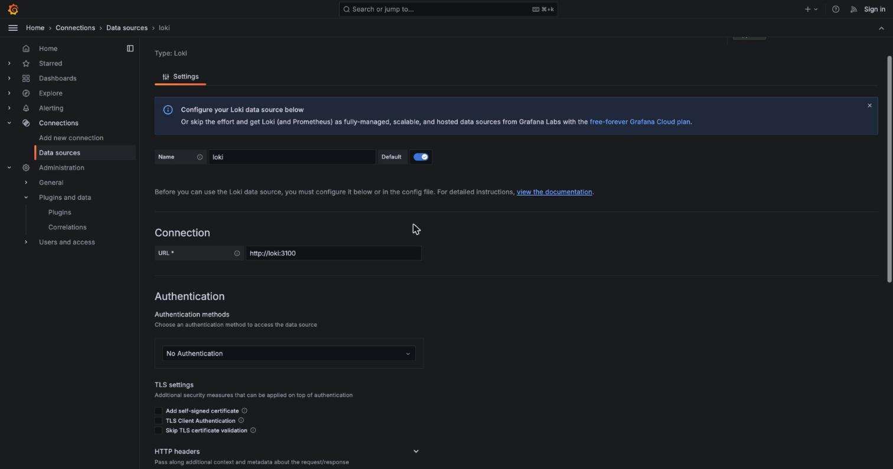

Save & test - успешно:

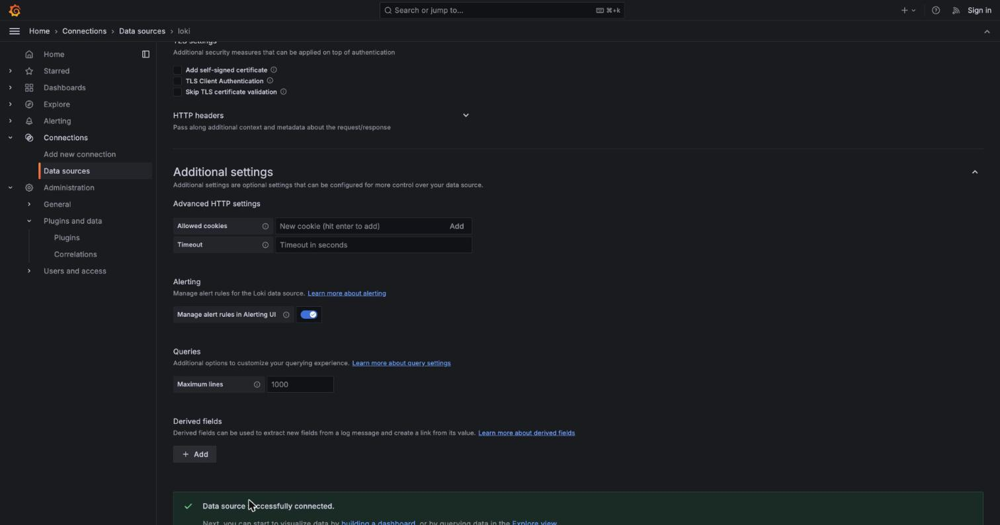

Дальше Zabbix, и тут вылезла та самая несовместимость. При добавлении датасурса Zabbix страница падала с `An unexpected error happened` (React error #130 из `alexanderzobnin-zabbix-datasource/module.js?_cache=6.10.1`). Плагину 6.10.1 нужна Grafana >= 11.6, а у нас 11.2.0. Во вкладке Version history у плагина нашли последнюю совместимую версию - 5.2.1 (Grafana >=10.4.8) и поставили ее:

```bash
docker exec grafana grafana cli plugins remove alexanderzobnin-zabbix-app
docker exec grafana grafana cli plugins install alexanderzobnin-zabbix-app 5.2.1
docker restart grafana
```

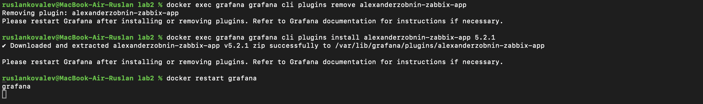

Вывод: версию плагина лучше фиксировать явно, иначе `grafana cli` тянет последнюю, а она может не подходить к старой графане.

После этого форма датасурса открылась. URL `http://zabbix-front:8080/api_jsonrpc.php` (именно имя контейнера фронта и внутренний порт 8080, а не 8082 - графана ходит изнутри docker-сети), Username/Password от забикса. Save & test показал версию API 6.4.21:

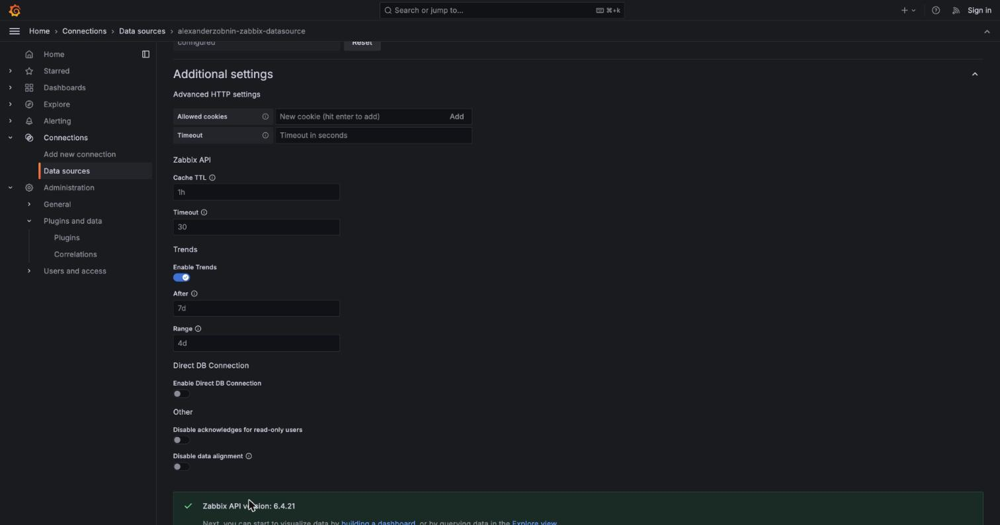

Explore → Loki, `{job="nextcloud_logs"}` - логи некстклауда на месте:

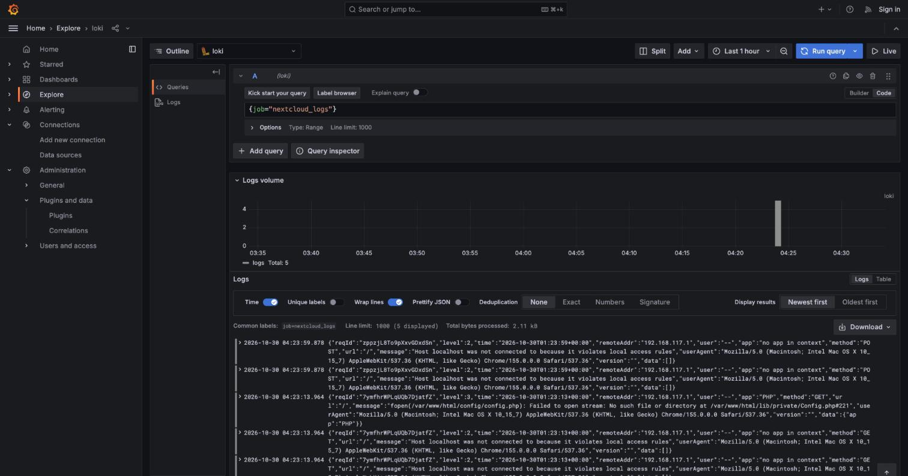

Explore → Zabbix, Query type Text, группа Applications, хост и айтем пинга. Видно и `unhealthy` в момент, когда включали maintenance:

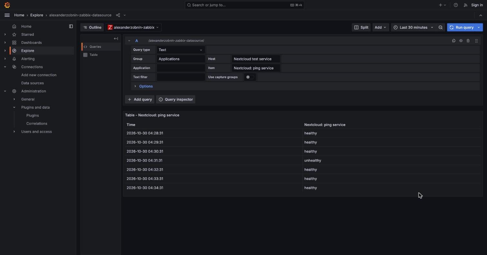

## Задание

### 1. "Поиграться" с запросами

Кроме простого выбора логов по `job` попробовали:

- `{job="nextcloud_logs"} | json | level >= 3` - парсим строку как JSON и оставляем только ошибки (у некстклауда level 0-4, 3 = error);
- `sum by (level) (count_over_time({job="nextcloud_logs"} | json [5m]))` - метрика из логов: сколько строк каждого уровня за 5 минут. Видно всплеск warning'ов (level 2) в момент установки некстклауда и одну ошибку (level 3):

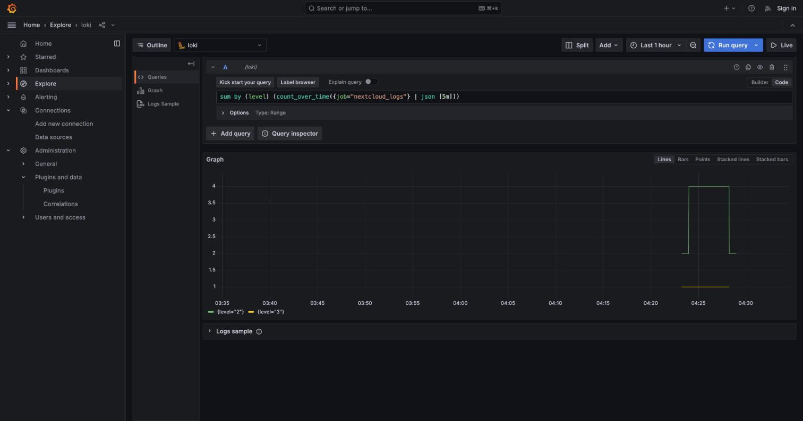

- в Zabbix - текстовый режим (Text) для нашего пинга, для числовых метрик Zabbix server можно Metrics.

### 2. Два дашборда

Nextcloud - статус (Zabbix). Stat-панель с цветной плашкой: value mapping `healthy` → зеленая "UP (healthy)", `unhealthy` → красная "MAINTENANCE". Рядом state timeline с историей, на ней видно красный кусок, когда включали maintenance mode:

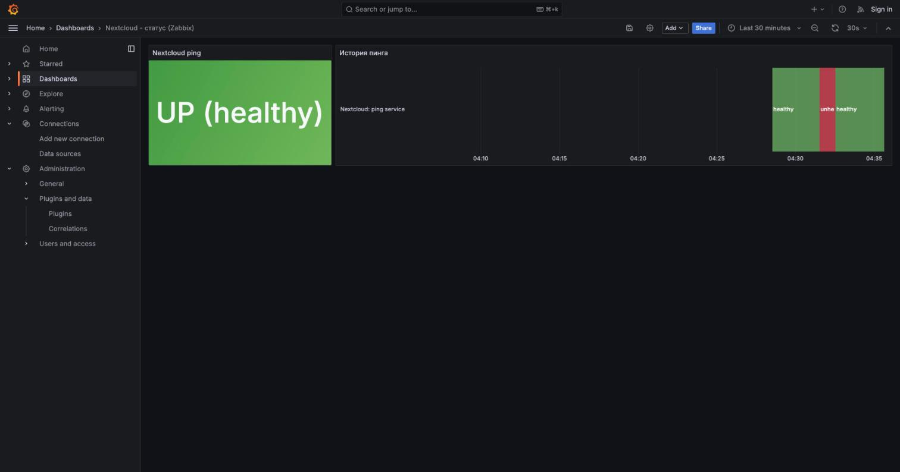

Nextcloud - логи (Loki). Таблица с логами: запрос `{job="nextcloud_logs"}`, трансформация Extract fields (JSON из строки лога) + Organize fields (убрали лишние колонки), колонка level раскрашена (2 - оранжевый, 3 - красный):

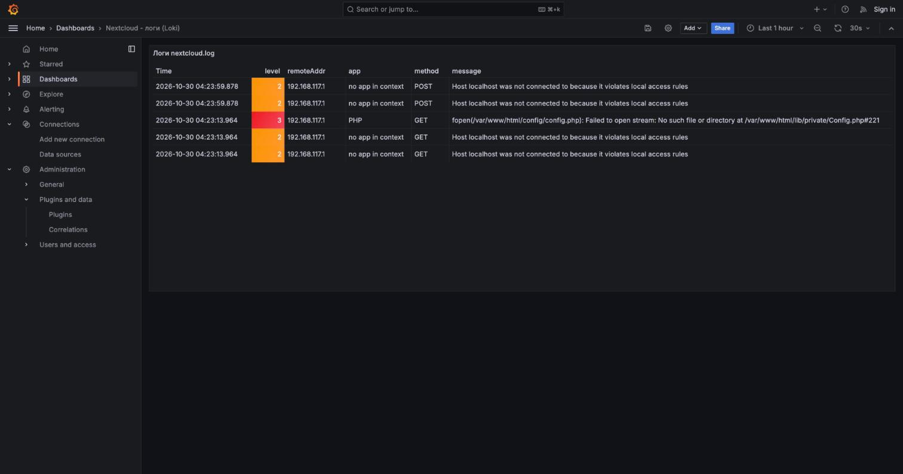

JSON обоих дашбордов лежит в `dashboards/`, их можно импортировать через Dashboards → New → Import. uid датасурсов там наши, при импорте на другой графане надо будет выбрать свои.

## Вопросы

### 1. Чем SLO отличается от SLA?

SLA (Service Level Agreement) - договоренность с клиентом, обычно юридическая, о том, какой уровень сервиса ему гарантируют и что будет, если не выполнят (штрафы, компенсации, возврат денег). Например, "доступность 99.9% в месяц, иначе 10% скидки".

SLO (Service Level Objective) - внутренняя цель команды по надежности, конкретное значение метрики за период. Например, "99.95% запросов к API успешны за 30 дней". Сама метрика называется SLI (Service Level Indicator).

Разница: SLA - внешнее обещание с последствиями, SLO - внутренняя цель, по которой команда живет. SLO обычно ставят строже SLA, чтобы был запас и проблемы замечались до нарушения договора. Из SLO получается error budget: сколько "ошибок" можно себе позволить, например на рискованные релизы.

### 2. Чем отличается инкрементальный бэкап от дифференциального?

Оба делаются поверх полного (full) бэкапа и сохраняют только изменения, но считают их от разной точки:

- инкрементальный - изменения с момента последнего бэкапа любого типа (полного или предыдущего инкрементального). Каждый бэкап маленький и быстрый. Но для восстановления нужен полный + вся цепочка инкрементальных по порядку, и если один из них битый, дальше не восстановишься;
- дифференциальный - изменения с момента последнего полного бэкапа. Каждый следующий больше предыдущего (накапливает все изменения с full). Зато восстановление проще: полный + один последний дифференциальный.

Коротко: инкрементальный экономит место и время бэкапа, дифференциальный - время и надежность восстановления.

### 3. В чем разница между мониторингом и observability?

Мониторинг - сбор заранее выбранных метрик и проверок плюс алерты на известные проблемы. Отвечает на вопрос "работает или нет / что сломалось". Мы заранее знаем, что смотреть: как наш пинг `status.php` и триггер на maintenance в Zabbix.

Observability (наблюдаемость) - свойство системы, при котором по ее внешним данным (метрики, логи, трейсы) можно понять, что происходит внутри, в том числе в ситуациях, которые заранее никто не предусмотрел. Отвечает на вопрос "почему сломалось". Тут важно собирать подробные данные и уметь задавать им произвольные вопросы, как мы делали с логами в Loki через `| json | level >= 3` и `count_over_time`.

Мониторинг - часть observability: он говорит, что есть проблема, а observability помогает разобраться в причине. В нашей лабе Zabbix - классический мониторинг, Loki + Grafana дают кусок observability (логи с запросами по ним). Для полной картины не хватает трейсов (например, Tempo/Jaeger).

## Выводы

- Подняли стенд Nextcloud + Loki/Promtail + Zabbix + Grafana. Логи некстклауда через promtail попадают в Loki, Zabbix по HTTP следит за `status.php` и поднимает Disaster при maintenance mode, Grafana показывает и то, и другое.
- Проверили триггер полностью: maintenance on → проблема → maintenance off → resolved.
- Сделали два дашборда: цветная плашка статуса из Zabbix и таблица логов из Loki.
- Наступили на несовместимость свежего плагина Zabbix со старой Grafana из методички, решили откатом на 5.2.1. Плюс под анонимным входом пришлось включать плагин через API. Версии лучше фиксировать явно (и в образах, и в плагинах).
