# Лаба 3. Ansible + Caddy

Задача: на целевом сервере установить Ansible и вебсервер Caddy.

Делали локально на маке (M-чип), подняли виртуалку Ubuntu 24.04 в OrbStack. Что встало: Python 3.12.3, pip 26.3, Ansible 14.6.0 (core 2.21.6), Caddy 2.11.9.

файлы:
- `ansible.cfg` - конфиг ansible
- `inventory/hosts` - хосты (`local_server`)
- `caddy_deploy.yml` - плейбук для Caddy
- `file_tasks.yml` - плейбук из первого задания
- `roles/caddy_deploy/` - роль для установки и настройки Caddy
- `screenshots/` - скрины

## Часть 1. Установка и настройка Ansible

Зашли в виртуалку Ubuntu и поставили pip через `get-pip.py`, как в методичке. В Ubuntu 24.04 стоит Python 3.12, он не дает ставить пакеты через pip в систему без venv и просит флаг `--break-system-packages`. С ним поставили pip и ansible:

```bash
curl https://bootstrap.pypa.io/get-pip.py -o get-pip.py && python3 get-pip.py --break-system-packages
python3 -m pip install --break-system-packages ansible
```

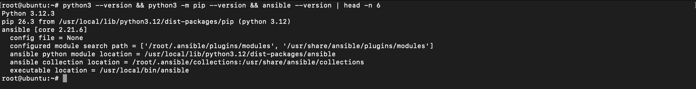

Создали папку `~/ansible`, положили туда `ansible.cfg` и `inventory/hosts` с хостом `local_server ansible_host=localhost`. Проверили коннект через `ping` и `setup` с ключом `-c local`:

```bash
ansible my_servers -m ping -c local
ansible my_servers -m setup -c local
```

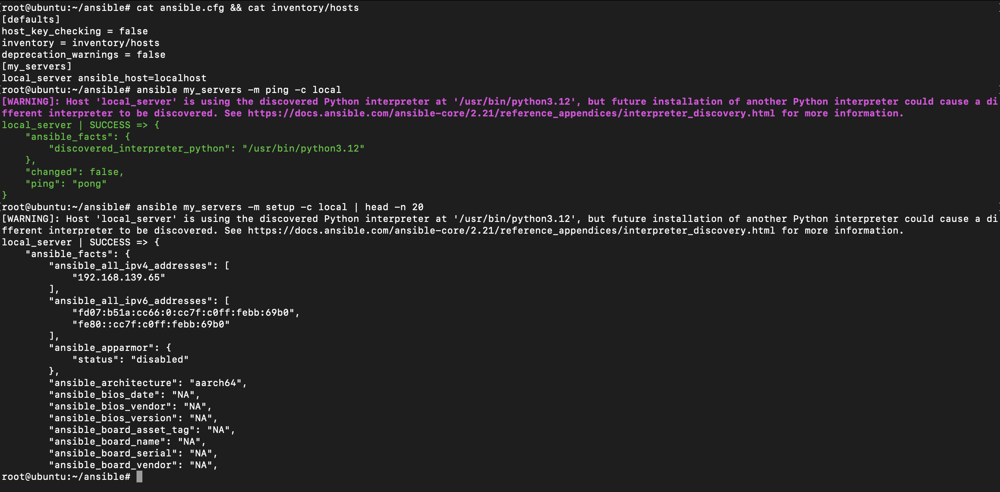

Дальше попробовали команды из шага 5. Создали файл `$HOME/test.txt` через модуль `shell`, проверили что он реально появился с текстом `test_file_content`, и удалили через модуль `file`:

```bash
ansible my_servers -c local -m shell -a 'echo test_file_content > $HOME/test.txt'
ansible my_servers -c local -m file -a 'path=$HOME/test.txt state=absent'
```

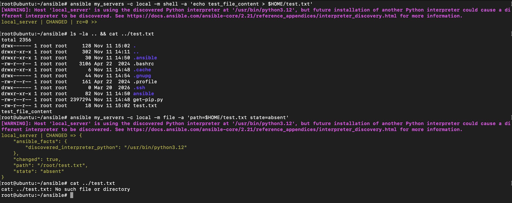

## Часть 2. Установка Caddy

Создали папку `roles` и сгенерировали шаблон роли через `ansible-galaxy`:

```bash
mkdir roles && cd roles
ansible-galaxy init caddy_deploy
tree
```

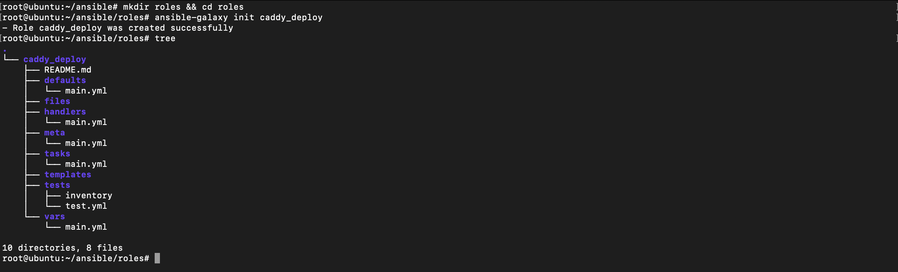

В `roles/caddy_deploy/tasks/main.yml` прописали шаги из методички: пакеты, ключ, репы Caddy и сам `apt` для установки `caddy`.

По ходу вылезло две мелочи. Во-первых, в чистой убунте не было пакета `gpg` (стоял только `gpgv`), а без него модуль `apt_key` падал, доставили `apt-get install -y gpg`. Во-вторых, новый ansible сыпал длинными ворнингами что `apt_key` и `apt_repository` deprecated, поэтому в `ansible.cfg` добавили `deprecation_warnings = false`, чтобы не засоряло терминал.

Создали `caddy_deploy.yml` и запустили плейбук:

```bash
ansible-playbook caddy_deploy.yml
service caddy status
```

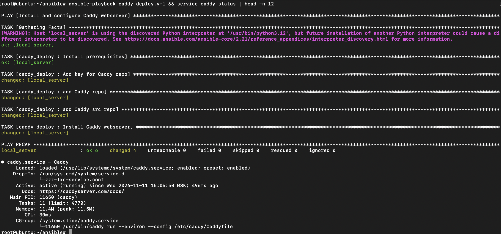

Caddy поставился, сервис `active (running)`.

## Часть 3. Домен и настройка Caddyfile

Так как делали локально на виртуалке без белого IP, вместо duckdns взяли домен `lab3.127.0.0.1.nip.io` (nip.io резолвит любой такой домен в `127.0.0.1`, а OrbStack сам прокидывает порты 80 и 443 с мака в виртуалку). В шаблон `roles/caddy_deploy/templates/Caddyfile.j2` добавили строчку `tls internal`, чтобы Caddy сам сгенерил локальный сертификат.

С логами в методичке была проблема: там указан путь `/var/log/caddy_access.log`, но сам Caddy крутится от юзера `caddy`, и прав писать прямо в `/var/log` у него нет (при релоаде падает с `permission denied`). Зато при установке пакета создается папка `/var/log/caddy` с нужными правами, поэтому в `vars/main.yml` указали `/var/log/caddy/caddy_access.log`.

Добавили в `tasks/main.yml` создание конфига из шаблона (`template`) и релоад сервиса (`service`), запустили плейбук:

```bash
ansible-playbook caddy_deploy.yml
cat /etc/caddy/Caddyfile
```

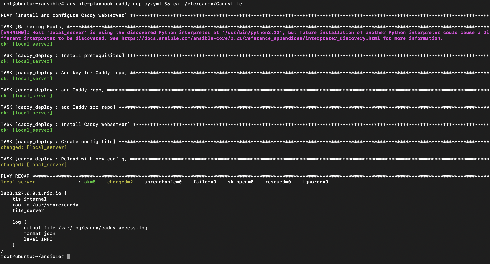

Зашли в браузере на `https://lab3.127.0.0.1.nip.io`, стартовая страница Caddy открылась по https:

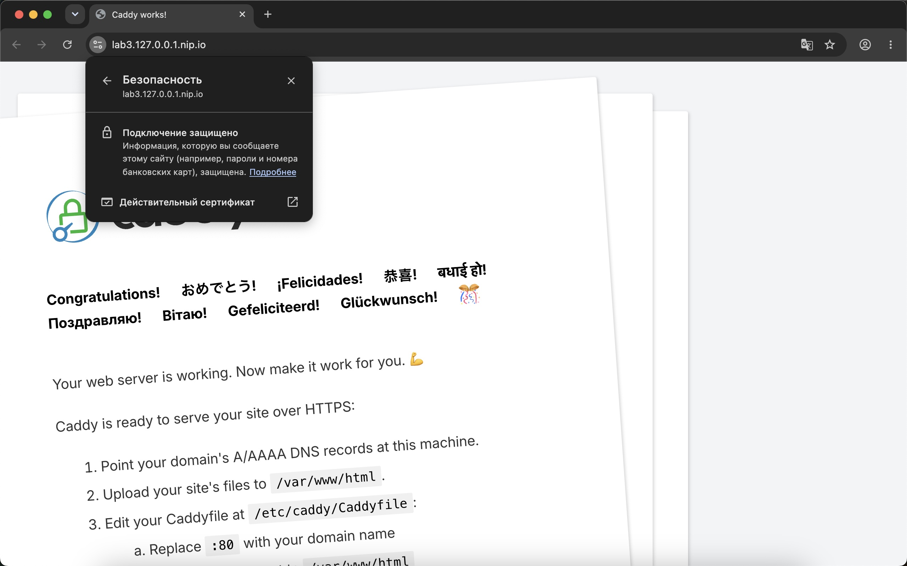

Сертификат выписался на наш домен через встроенный CA Caddy:

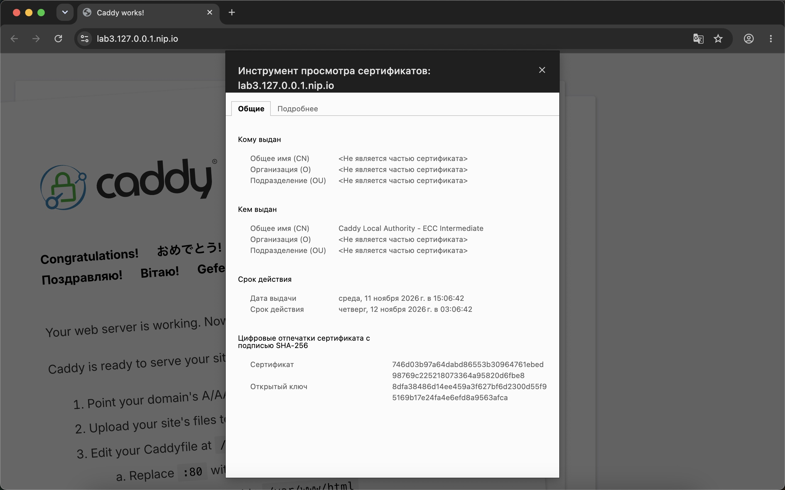

## Задание

### 1. Плейбук с файлом

Переписали команды из шага 5 первой части в один плейбук `file_tasks.yml`. Сделали создание файла `test.txt`, потом перезапись текста внутри на `updated_file_content_lab3` и в конце удаление. Между шагами добавили чтение файла и `debug`, чтобы в выводе было видно что текст реально менялся:

```bash
ansible-playbook file_tasks.yml
```

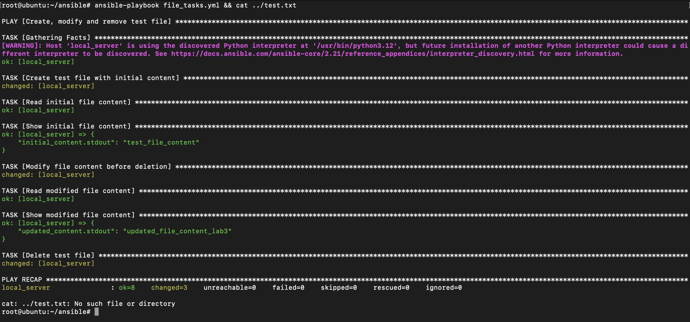

### 2. Своя страница и заголовки в Caddy (2a)

Сделали простой `index.html` с `Hello world!` и положили в `roles/caddy_deploy/files/index.html`. В `tasks/main.yml` добавили шаг с копированием этого файла в `/var/www/html/index.html`. В шаблоне `Caddyfile.j2` поменяли `root` на `/var/www/html` и добавили блок `header`, который вешает заголовки `X-Deployed-By: Ansible` и `X-Lab-Number: 3`.

Запустили плейбук заново:

```bash
ansible-playbook caddy_deploy.yml
cat /etc/caddy/Caddyfile
```

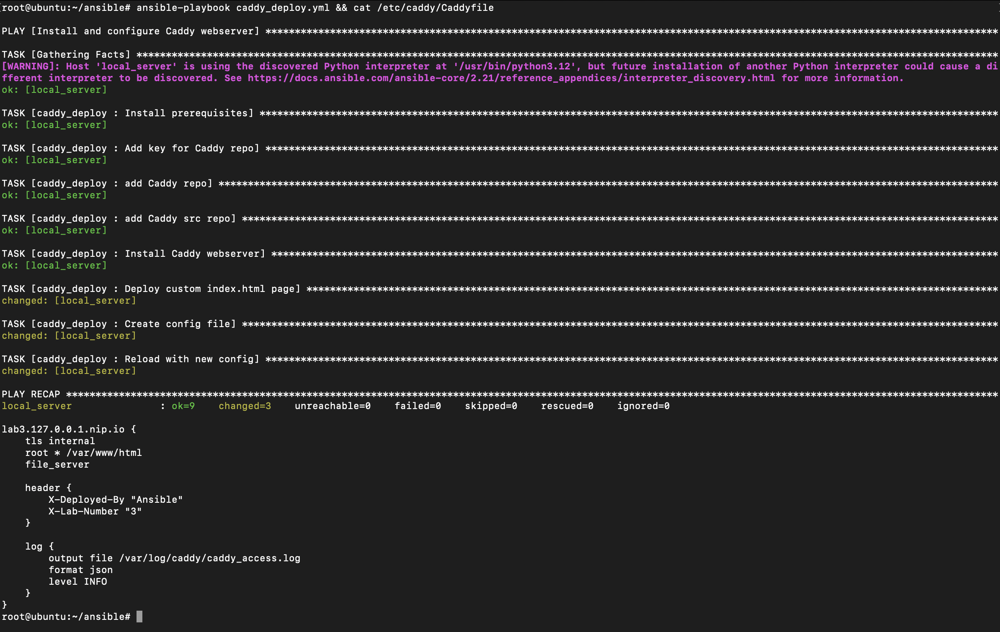

Проверили через `curl -kI`, что наши заголовки приходят в ответе, и глянули что в `/var/log/caddy/caddy_access.log` пишутся логи в json:

```bash
curl -kI https://lab3.127.0.0.1.nip.io
tail -n 1 /var/log/caddy/caddy_access.log
```

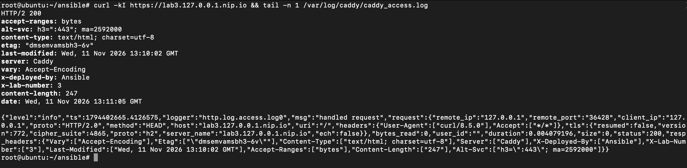

Обновили страницу в браузере, теперь там наш `index.html`:

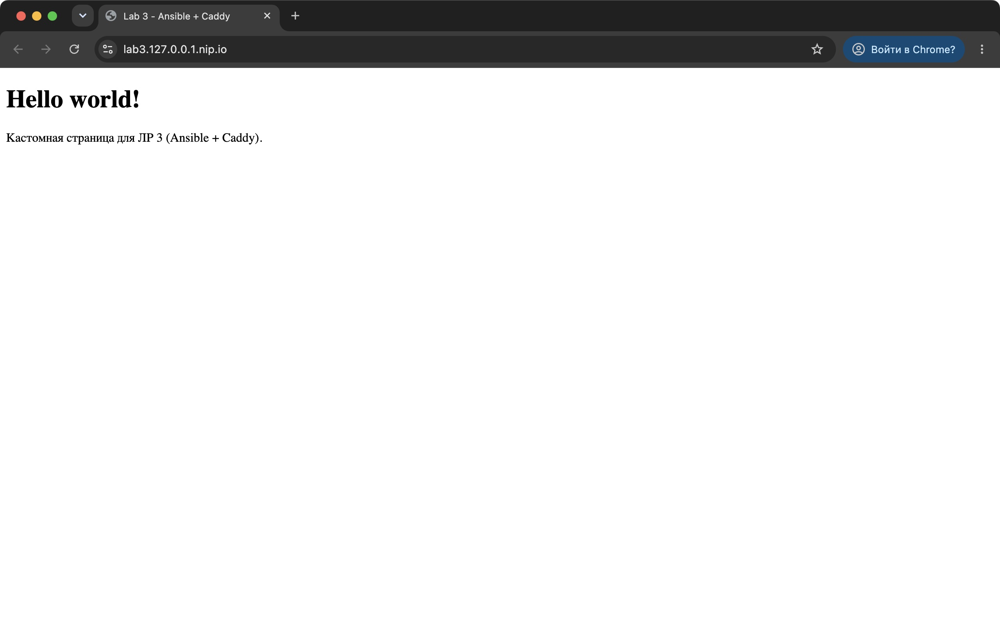

## Выводы

- Поставили Ansible и Caddy на виртуалку с Ubuntu, попробовали и обычные ad-hoc команды, и плейбуки с ролями, переменными и шаблонами Jinja2.
- Удобно, что плейбуки идемпотентные: при повторном запуске пакеты и репы заново не качаются (`ok`), применяются только те шаги, где что-то поменялось (`changed`).
- Сделали отдельный плейбук для создания, изменения и удаления файла и докрутили конфиг Caddy: подложили свой `index.html` и добавили кастомные заголовки через `header`.
- Из граблей: на свежей убунте pip не ставит пакеты без `--break-system-packages`, для `apt_key` надо руками доставлять `gpg`, а лог Caddy из методички (`/var/log/caddy_access.log`) не работает из-за прав юзера `caddy`, надо класть в `/var/log/caddy/`.
